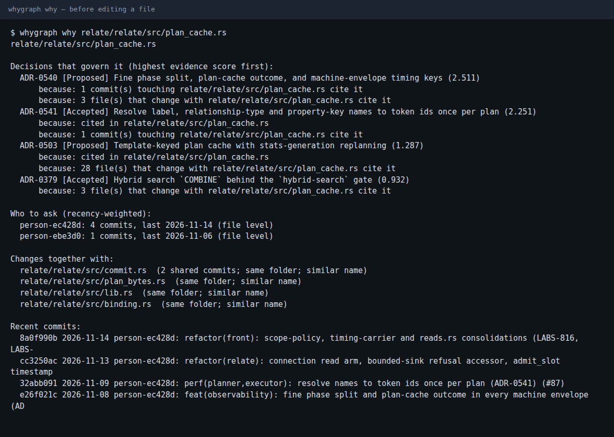

# whygraph

**A decision graph for coding agents, stored in an embedded [Relate](https://github.com/relatedb/relate) graph.**
Before an agent edits a file it asks one question: *why is this file the way it is?* whygraph answers it from
the repository's own history: the architecture decisions (ADRs) that govern the file, the people who know it,
and the files that change with it. It runs in-process (no server, one `.rl` file) and speaks MCP, so Claude Code,
Cursor or Codex can call it as a tool.

Demo video (1:38): https://youtu.be/EBa4CtHUoP4



## Use case

A coding agent about to edit a file cannot see why the file is the way it is. The reasons sit in architecture
decision records, in commit messages and in the people who wrote the code, so the agent re-opens settled
decisions and misses the file that always changes with this one. The relationships that matter are
person → commit → file, commit or file → the decision it cites, and decision → the decision that amends or
supersedes it.

## How it uses Relate

- **Mode: single file.** `whygraph index` writes one `.rl` file; every query, the CLI and the MCP server open it
  in-process with `relate.connect(path, read_only=True)`, so using the store never rewrites it. The eval is the exception: it builds about 20 throwaway graphs with
  `relate.connect(":memory:")`, one per holdout cutoff and per test.
- **Why this mode:** a decision graph belongs next to the repository it describes. One file can be committed,
  copied to another machine, handed to any MCP client, opened by a judge, and deleted when stale; an index is
  rebuilt, never merged. No server process means nothing to start before an agent asks its first question.
- **What the graph models:** people, commits, files and decisions, with the edges below.

## Where the data lives

[`data/relate.rl`](data/relate.rl) (3.6 MB) is a persistent store you can open without building anything: the
public [relatedb/relate](https://github.com/relatedb/relate) repository at commit `2346dec599`, 483 commits,
566 ADRs, author names replaced with pseudonyms. After `pip install .`:

```bash
whygraph --store data/relate.rl why relate/relate/src/plan_cache.rs
whygraph --store data/relate.rl search "plan cache invalidation"
claude mcp add whygraph -- whygraph --store "$PWD/data/relate.rl" mcp
```

It was built with `whygraph index --repo <clone of relatedb/relate> --rev 2346dec59924eb730a5041d15bcfbcbf06d5de79
--anonymize --store data/relate.rl`; `demo/demo.sh` rebuilds the same graph from scratch.

## Graph model

```
(:Person)-[:AUTHORED]->(:Commit)-[:TOUCHES]->(:File)
(:Commit)-[:CITES]->(:Decision)     commit message names an ADR
(:File)-[:CITES]->(:Decision)       file text at the indexed revision names an ADR
(:Decision)-[:REFERENCES|AMENDS|SUPERSEDES]->(:Decision)
```

Relate features used: embedded `relate.connect()` store, Cypher with `UNWIND` batch writes and `CALL (c, r) { }`
subqueries, uniqueness constraints, **full-text indexes** with `SEARCH ... SCORE`, multi-hop
pattern matching for the co-change and "decisions via neighbours" queries, and an in-memory store for the eval.
Ranking on top of the graph (recency-decayed ownership, `1/files-in-commit` coupling, an `1/ln(2+cites)`
decision weight, reciprocal-rank fusion) is a few lines of Python in `whygraph/query.py`.

## Install and run (about a minute; tested with Python 3.9.25, 3.12.3 and 3.15.2, relate-db 1.1.0)

```bash
git clone https://github.com/StartupBros-com/whygraph && cd whygraph
python3 -m venv .venv && . .venv/bin/activate
pip install .                      # only dependency: relate-db (>= 1.1.0)
demo/demo.sh                       # clones relatedb/relate at a pinned commit, indexes it, runs the queries
```

Or on your own repository (it needs `git`; ADRs are numbered markdown files under `docs/adr/`, change with `--adr-dir`):

```bash
whygraph index --repo ~/code/myrepo --store whygraph.rl
whygraph why src/server/auth.rs      # decisions + owners + co-changing files + recent commits
whygraph search "cache invalidation" # full-text search of decisions
whygraph decision 118                # one ADR, what supersedes it, where it is cited in code
whygraph coupled src/server/auth.rs  # co-change history only
```

Output is JSON when piped, a readable digest on a terminal (`--text` / `--json` force either).
Errors say how to fix the call, for example `no file named 'x'... Try: whygraph find <fragment>`.

### Use it from a coding agent (MCP)

```bash
claude mcp add whygraph -- whygraph --store /abs/path/whygraph.rl mcp
```

Tools: `why_file`, `get_decision`, `search_decisions`, `who_owns`, `changes_with`, `find_file`.
Suggested line for `CLAUDE.md` / `AGENTS.md`: *"Before editing a file, call whygraph `why_file` and respect the
decisions it returns; if a decision is superseded, follow the newer one."* The server is a dependency-free
stdio JSON-RPC loop (`whygraph/mcp.py`); `tests/test_whygraph.py` covers the handshake, tools, errors and stdio.
Checked with a real client on 2026-11-19: after `claude mcp add --scope project whygraph -- whygraph --store relate.rl mcp`, Claude Code 2.1.328 reported the server connected, called `why_file` on `relate/relate/src/plan_cache.rs` and answered from the result ([transcript excerpt](docs/screenshots/2_mcp.txt)).

## Tests and eval

```bash
pip install pytest && pytest -q           # 16 tests on synthetic git repositories
python eval/run_eval.py --repo <clone of relatedb/relate> --rev 2346dec59924eb730a5041d15bcfbcbf06d5de79
```

The eval replays the repository's later commits against a graph built only from earlier ones. Numbers, baselines,
what did and did not work, and the caveats are in [eval/README.md](eval/README.md). Short version: the graph
found the governing decision more often than text search or grep on a small sample (10 of 12 replayed commits at
the 70% split, against 4 for full text), a fusion of history, folder and name signals scored highest at predicting
*co-changing files* (intervals overlap); for *who to ask*, "whoever commits
most" is hard to beat on a repository with one dominant author.

## Prior work

Built for this contest from scratch (first commit 2026-11-18). No code was reused from earlier projects. Related
ideas: `git log`-mining co-change analysis in the style of code-maat, and Claude Code auto-memory (the
`memory-dream` plugin consolidates notes but has no graph). A search of the entrant's past coding-agent sessions
found no earlier decision-graph tool. The demo target is the open-source
Relate repository itself, which keeps its ADRs in `docs/adr/`; `--anonymize` replaces author names with
pseudonyms so screenshots carry no personal data.

## Layout

`whygraph/build.py` git + ADRs to graph, `whygraph/query.py` the Cypher and ranking, `whygraph/cli.py` CLI,
`whygraph/mcp.py` MCP server, `eval/run_eval.py` temporal-holdout eval, `demo/` reproducible demo and screenshot
renderer, `tests/`. Apache-2.0.
